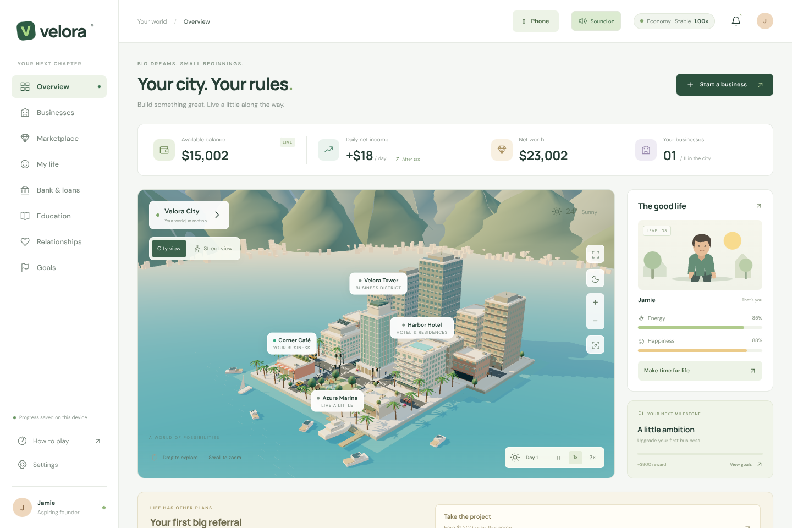

# Velora

A 3D city business and life game that runs in your browser.

**▶ Play now: https://elxngo.github.io/velora/**

## What is Velora?

You arrive in Velora, a sunny harbour city, with $15,000, a small corner café and rent to pay. Build a business empire, study for a career, find someone to share your life with, and see whether you can become a billionaire. It isn't easy: wages, tax, recessions and wear and tear are all part of the game.

## Features

- **A living 3D city:** golden-hour harbour views, traffic that stops at red lights, and a street view you can walk around.
- **11 businesses to own:** from the Corner Café to the Skyline Exchange. Bigger ones unlock with qualifications, a good credit score and experience.
- **A real economy:** booms and recessions, staff wages, progressive tax, insurance, loans, overdrafts and repossession.
- **Run things your way:** set prices and staff pay, launch marketing campaigns, and read the market report to time your moves.
- **A life outside work:** study for a career, take care of your energy and happiness, date, and get married.
- **Sound:** a quiet city skyline from above, real road sound at street level.

## How to play

1. Open the game and enter your name, or continue with Google.
2. Work a shift each day and upgrade your café to get started.
3. Buy more businesses, keep them maintained, and look after your staff.
4. Watch the economy: cut prices in a recession, go premium in a boom.
5. Don't let your bank balance stay negative for 7 days, or the bank takes your best asset.

One game day lasts one minute. Use the 3× button to speed things up.

## Controls

| Where | How |
|---|---|
| City view | Drag to rotate, scroll or +/− to zoom, select a building or its label to manage it |
| Street view | W A S D or arrow keys to walk, drag to look around |
| Phone | Tap and drag. Street view has on-screen arrows. |

## Your progress

Sign in with Google and your progress saves to your account, so you can carry on from any phone or computer. Guests can play too, but a guest save stays in that one browser. See the [privacy page](https://elxngo.github.io/velora/privacy.html).

## Credits

Made by Elango. 3D rendering uses [three.js](https://threejs.org) (MIT licence); fonts are DM Sans and Manrope (SIL Open Font Licence).

© 2026 Elango. All rights reserved. The game's source code is private.
